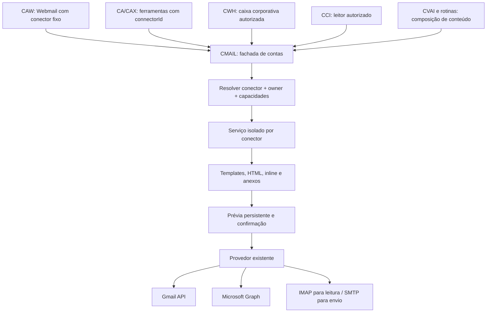

# Proposta: CMAIL com contas nomeadas

Data: 04/11/2026. **Proposta de evolução; implementação por etapas.**
Atualização: a [primeira etapa opcional](named-connectors.md) implementa registro
Python, isolamento de estado e adaptador legado. O restante deste documento
continua proposta; não representa migração dos consumidores nem OAuth por conector.
Outra etapa disponível: [anexos comuns no envio novo](outgoing-attachments.md),
com prévia congelada. Não inclui respostas/encaminhamentos ou migração dos hosts.
Pedido de Fábio: concentrar o e-mail no CMAIL, admitir várias contas de cada
tipo e exigir a escolha do conector nas operações. Nesta primeira etapa,
o Webmail conserva uma conta fixa configurada pelo host e sua interface atual.
O seletor visual pertence a uma etapa posterior.

## O que já existe

| Camada | Evidência no fonte inspecionado | Consequência |
| --- | --- | --- |
| Provedores | `cmail/service.py`, `mail.py`, `gmail.py`, `graph.py`, `gmail_smtp.py` | Gmail API, Microsoft Graph, IMAP/SMTP e Gmail por arquivo já existem; reutilizar |
| Autenticação | `auth.py`, `google_auth.py`, `gmail_file.py` | Separar identidade, consentimento e transporte; Gmail por arquivo também usa OAuth |
| Conta ativa | `Config.mode`, `MailService`, `Store.bound_identity(provider, owner)` | A composição escolhe um modo; a consulta do vínculo retorna uma identidade por provedor/owner |
| Identidades | `database.py`, `store.py` | Unicidade atual por provedor/tenant/subject e recusa de transferência entre owners; adicionar apenas um argumento não resolve múltiplas contas |
| Conteúdo de saída | `api.py:describe`, `store.py:prepare`, `inline_images.py` | Texto, HTML e imagens CID existem; anexos comuns são explicitamente recusados |
| Conteúdo recebido | `api.py`, `annotation_reader.py` | Leitura de anexos já existe; capacidades variam por provedor |
| Templates | `template_render.py`, `appearance.py`, `docs/email-templates.md` | Renderização estrita e aparência empresa/pessoa já existem; não criar outro renderer |
| Envio confirmado | `prepare_send`, `execute_send`, claim persistente no Store | Reutilizar prévia congelada, confirmação e ausência de repetição automática após resultado incerto |
| Ferramenta CA | `ca/email_tools.py`, `ca/email_scope.py` | O host autentica o turno; o modelo não escolhe owner nem fornece credenciais |
| CWH | `bridge/company_mail.py` | Caixa da empresa usa owner próprio do CWH e principal humano; não equivale à caixa pessoal de cada atendente |
| CCI | Leitor público `annotation_reader(owner_id)` | Consumir leitura autorizada, sem adquirir poderes de envio por consequência |

O histórico versionado distingue HTML (`482daea`) e inline CID (`ef7a1c2`).
Não foi localizado envio genérico de arquivos na implementação atual nem
nessas revisões. Os scripts históricos GMAIL/OMAIL/IMAIL já enviavam anexos,
mas constituem outro caminho de transporte. Base64 é codificação: uma imagem
inline não equivale ao contrato de anexar um PDF/XML.

`python -m cmail.enviar --gmail` é uma fachada do CMAIL para `gmail-file`,
não um segundo motor. Gmail por arquivo aceita API ou SMTP/XOAUTH2 explícito;
o transporte SMTP não ganha leitura de caixa automaticamente.

## Arquitetura proposta



Preferir uma fachada/registro que componha os serviços existentes, sem
reescrever todos os provedores nem exigir um processo/porta para cada conta.
Carregar os conectores sob demanda, com limites de conexões, tamanho de
conteúdo, paginação e tempo. Não impor uma quantidade comercial arbitrária
de contas; recursos finitos continuam exigindo controle.

### Nome, identidade e autorização

- `connectorId`: identificador estável, por exemplo `fabio-gmail`,
  `fabio-gmail-arquivo`, `dorotech` ou `lakatos`. Nome exibido pode mudar.
- `provider`: Google, Microsoft ou IMAP/SMTP; separado de `authMode` e dos
  transportes de leitura/envio. Dois conectores podem usar o mesmo provedor.
- `ownerId`: identidade autenticada pelo host; nunca argumento livre do modelo.
- Vínculo efetivo: conector + owner + identidade verificada pelo provedor.
  Saber o nome do conector não concede acesso à conta.
- Uma caixa corporativa compartilhada exige grants explícitos do host.
  A LIA multiusuário deve continuar resolvendo a conta Microsoft do usuário
  autenticado; o alias `lakatos` não torna a caixa de Fábio acessível a todos.
- Aliases informais resolvem para um único ID autorizado. Havendo ambiguidade,
  pedir a escolha; não inferir remetente por destinatário ou nome da empresa.
- O mesmo endereço cadastrado duas vezes não deve ganhar duas filas de envio
  sem decisão explícita; detectar duplicidade e definir se são aliases ou
  vínculos realmente independentes.

### API e compatibilidade

Novo contrato versionado exige `connectorId` em leitura, busca, preparação,
execução, ações sobre mensagens, aparência e leitores incorporados.
`list_connectors` retorna somente nomes, capacidades e estados autorizados
ao principal atual, sem caminhos privados ou material de autenticação.

O Webmail não precisa de seletor: o adaptador do host injeta seu conector fixo
em todas as chamadas. O Fábio Dell permanece em Gmail; a LIA, em Microsoft.
A API antiga pode existir como adaptador explícito para esse vínculo fixo
durante a migração. O novo contrato recusa ausência/ambiguidade do conector;
não escolhe silenciosamente o primeiro nem faz fallback de transporte.

No OAuth, nonce/PKCE/state, callback e retorno precisam ficar vinculados ao
conector, ao owner e à sessão original. Não aceitar `connectorId` da query
como autoridade para redirecionar um consentimento. Preservar o callback
hospedado atual enquanto o roteamento interno ganha esse vínculo.

`gmail-file` hoje aceita somente operador local sem owner. Integrá-lo aos
hosts exige contrato explícito de conta de serviço e autorização; remover
essa verificação ou fabricar um principal vazio seria uma regressão.

### Configuração e persistência

Manter **uma entrada canônica**, `CMAIL_CONFIG_FILE`, apontando para o JSON
revisionado. Propor um novo schema com registro de conectores, configuração
por conta e conector fixo de Webmail. O formato definitivo deve ser validado
em contrato antes do desenvolvimento; os nomes a seguir são ilustrativos:

```json
{
  "schemaVersion": "2.0",
  "webmailConnectorId": "fabio-gmail",
  "connectors": {
    "fabio-gmail": {"provider": "google", "authMode": "oauth-web"},
    "fabio-gmail-arquivo": {"provider": "google", "authMode": "oauth-file"},
    "dorotech": {"provider": "imap-smtp", "authMode": "password-ref"},
    "lakatos": {"provider": "microsoft", "authMode": "oauth-web"}
  }
}
```

Esse exemplo **não é uma configuração válida da versão atual**. Dados de
servidor, tenant, remetente esperado, transporte e referências de segredos
precisam do schema completo. Referências a variáveis `.env` podem ser
admitidas explicitamente pelo parser, sem criar um segundo cadastro paralelo.

O padrão vigente continua sendo `<instância>/security/cmail/`; não usar
`temp/`, `.agents/` ou uma nova `.state/` para conexões. Para contas novas,
propor `security/cmail/accounts/<connectorId>/` com Store, OAuth e prévias
próprios. Preservar o layout interno nativo, ACLs e DPAPI. Os caminhos são
resolvidos pela base documentada do JSON, nunca pelo diretório de execução.

Isolar também caches de busca, cursores de paginação, listas, preferências,
anotações, histórico, rascunhos e assets de prévia. IDs de mensagem/rascunho
de um provedor não são globalmente únicos entre caixas. Não compartilhar
Store entre conectores esperando que o nome no prompt forneça isolamento.

O conector legado pode continuar apontando para seu diretório atual. Uma
migração posterior de pastas segue [state-storage.md](state-storage.md),
com serviço parado, preservação integral e rollback; não mover tokens por
conveniência nem copiar DPAPI entre usuários ou máquinas.

### Conteúdo, templates e anexos

Um único modelo de mensagem no CMAIL deve cobrir destinatários To/Cc/Bcc,
assunto, texto alternativo, HTML, anexos comuns e imagens inline CID.
Cada capacidade precisa ser declarada pelo provedor, sem descarte silencioso.

Preservar o renderer existente e a herança de aparência. Definir precedência
explícita entre padrão da empresa, conector, pessoa e tipo de mensagem,
evitando duas assinaturas. Templates e logos editáveis pertencem ao consumidor;
o pacote genérico não recebe identidades, clientes ou modelos fiscais reais.

Arquivos chegam por referências autorizadas/artefatos do host. O modelo não
recebe credenciais, caminhos irrestritos ou grandes blobs base64. Na preparação,
validar tipo, tamanho e acesso; congelar bytes e hashes em armazenamento
privado limitado. A confirmação não pode depender de um PDF que mudou depois.

Gmail API e SMTP reutilizam uma montagem MIME comum; Graph recebe seu payload
correspondente. Tratar anexos comuns e `isInline` separadamente. Inicialmente,
recusar acima do limite suportado; uploads grandes podem ser uma capacidade
posterior. Resposta/encaminhamento só promete anexos preservados quando o
provedor e a prévia demonstrarem isso.

O draft precisa fixar conector, revisão relevante de configuração,
identidade/owner, destinatários, HTML renderizado, anexos e inline. A execução
confere o mesmo vínculo. Rotação normal de token não invalida conteúdo;
troca de caixa, identidade, remetente ou transporte exige nova preparação.
Depois de claim/resultado incerto, não repetir automaticamente nem trocar
de provedor. Recibo aceito não comprova entrega ou leitura.

### Consumidores e disparadores auxiliares

| Dono | Mudança proposta |
| --- | --- |
| CMAIL | Registro, contratos, capacidades, estado por conector e anexos; dono de todo transporte |
| CA/CAW | Contexto autenticado e ferramentas com conector explícito; Webmail fixo; compatibilidade controlada |
| CAX | Mesmo CMAIL por ferramenta autorizada; definir principal do executor sem reaproveitar tokens curtos do navegador |
| CWH | Conector fixo da empresa e grants aos atendentes; preservar autenticação humana e isolamento da conta WhatsApp |
| CCI | Seleção de fonte de leitura por conector/owner, cursores isolados; sem habilitação automática de novas contas |
| CVAI | Conteúdo/campanha e template no consumidor; preparação/envio exclusivamente no CMAIL |
| Agente fiscal | Clientes, valores, PDFs/XML e escolha do conector; NFSe continua módulo independente |
| Tools locais de e-mail | Reduzir a adaptadores/orquestração; retirar MSAL/SMTP próprios depois do aceite equivalente |

Uma skill geral de e-mail pode descobrir os conectores autorizados; skills
de processo escolhem cliente/template e pedem a operação. Skills não são
conectores e não precisam conter credenciais nem replicar transporte.

Agendamento é autorização distinta de uma interação web. Um job precisa de
delegação persistente, conector fixo, escopo de operação, destinatários/política
aprovados e possibilidade de revogação. Não persistir `emailScopeToken` ou
`emailContext` de turno para tentar usá-los no dia seguinte.

## Evidências operacionais desta análise

- Fontes CMAIL `2de2ec0`, CA `14c77b5`, CWH `524d111`, CVAI `cf195a3` e
  Lakatos_ADM `32d8535` alinhadas ao remoto no pull. CCI avançou de `fc588c6`
  para `34e2a5b`, CServer de `d1f4a8e` para `79c7bc7`: governança/documentação.
- Alterações locais do agente pessoal e arquivos não rastreados dos demais
  checkouts preservados. Não confundir alinhamento remoto com árvore limpa.
- No Python local, CMAIL `26.11.3.post2` e CA `26.11.4.post2`: comparação de
  67 e 272 arquivos de implementação, respectivamente, sem diferenças com os
  fontes. Isso não substitui inspeção de cada processo carregado.
- CWH `26.11.3.post8` e CCI (`crania-cwwa`) `26.11.3.post4`: 343 e 93 arquivos
  instalados comparáveis sem diferenças. CVAI `26.10.26.post1`: diferenças
  brutas de finais de linha, sem diferenças nos fontes Python após normalização.
  `pip check` passou. Não houve instalação nem reinício local nesta análise.
- No Edge autenticado, perfil pessoal exibia Gmail autorizado e Webmail
  habilitado. LIA exibia KPI indisponível, ação Habilitar e-mail e preferência
  Webmail desmarcada. Essa tela não identifica sozinha a causa de desconexão.
- Histórico visível da LIA: envio aceito em 02/11, depois agendamento recusado
  e erro do motor. Nenhuma repetição do envio foi feita nesta análise.
- Coordenação solicitada ao chat **LIA .154 Suporte**, responsável pelo SYNC
  concorrente do SERVER-LIA. Diagnóstico final remoto e aceite após instalação
  permanecem pendentes; não declarar toda a frota sincronizada.

Correções relevantes já existentes: CMAIL `6a2da93` permite renovação Microsoft
com `offlineAccess` explícito e preserva erros MSAL; CA `4bb778e` evita que
composição apenas Webmail bloqueie conversas sem tools de e-mail.
`offlineAccess` exige consentimento apropriado; aumentar horas da sessão web
não prolonga automaticamente um token Microsoft. Não habilitar isso por
migração silenciosa.

A investigação da LIA deve separar: configuração efetiva; conta do serviço
e DPAPI; owner/vínculo OAuth; refresh/consentimento; contexto assinado do CA;
capacidades selecionadas; e autorização de agenda. Um erro genérico do motor
não é prova de falha do Outlook. SysQuality possui integração própria e não
herda a caixa da LIA por estar no mesmo servidor.

## Execução proposta e critérios de aceite

1. Aprovar contrato/schema e inventário por consumidor; não mudar a UI.
2. Introduzir registro e adaptador legado fixo; testar duas contas do mesmo
   provedor e dois owners, incluindo negação de acesso cruzado.
3. Estender composição/preparação/provedores para anexos, reaproveitando
   templates e inline; validar estrutura MIME/Graph sem envio real.
4. Adaptar CA/CAX, CWH e leitores CCI/CVAI; substituir transportes duplicados
   somente após equivalência funcional e contrato de autorização.
5. Migrar uma instância de teste; preservar Gmail pessoal e Microsoft LIA,
   paths, owners, preferências e consentimentos. Conferir rollback.
6. Homologar leitura autenticada e prévias. Envio real apenas em teste
   específico autorizado, com destinatário/conteúdo definidos e recibo.

Testar ainda: callback concorrente por conta, conta errada no consentimento,
token expirado vs falha transitória, reinício, mudança de conector após prévia,
arquivo alterado, template ausente, Cc/Bcc, anexos+inline, página/ID de outra
caixa, revogação, job sem grant, timeout com resultado incerto e ausência de
regressão na composição de Webmail atual. Preservar os contratos Google de
Drive/Docs/Sheets: autorização Gmail não concede essas capacidades.

A seleção visual de contas não integra estes aceites. Nesta entrega foram
analisados contratos e redigida a proposta; o desenvolvimento continua futuro.
